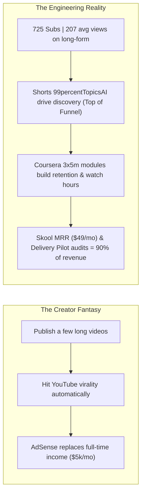

# Sanity Check, Current Status & Reality Audit

Channel: **[@RifatErdemSahin](https://www.youtube.com/@RifatErdemSahin)**  
Shorts Reference Series: **[rifaterdemsahin/99percentTopicsAI](https://github.com/rifaterdemsahin/99percentTopicsAI)**  
Date: **November 2026**

---

## 1. Executive Reality Check: Perception vs. Reality



---

## 2. Current Status Audit (Hard Numbers)

| Metric | Current Actual | Target Milestone | Variance / Deficit | Reality Assessment |
| :--- | :---: | :---: | :---: | :--- |
| **Subscribers** | **725** | 1,000 (YPP) | **-275 subs** | **Very close (72.5% done).** Can be cleared in 6–8 weeks with 3 shorts/wk. |
| **Catalog Videos** | **38** | 50 | -12 videos | Good baseline library. Existing videos provide evergreen search foundation. |
| **Total Views** | **7,015** | 150,000 (90-day target) | -142,985 | View counts are modest (avg 207/video). Needs algorithmic hook disruption. |
| **Long-Form Avg** | **207.5 views** | 1,500 - 3,000 views | -1,292 | Decent organic search baseline, but thumbnails and titles lack click urgency. |
| **Shorts Avg** | **98.8 views** | 2,500 - 5,000 views | -2,401 | Shorts are under-leveraged (only 8 published). `99percentTopicsAI` fixes this. |
| **Skool Members** | **Early stage** | 100 paid ($4.9k MRR) | -100 | Currently zero systematic funnel connecting video viewers to community. |
| **Production Bandwidth** | **Solo Creator** | Max 10.5 hrs/week | 0 buffer | High risk of burnout if attempting full 60m productions every week. |

---

## 3. The 4 Brutal Realities of Tech Content in 2026

### Reality 1: The YouTube AdSense Trap
* **The Myth:** *"When I get monetized on YouTube, I will have a successful content business."*
* **The Reality:** In the AI/tech niche, 30,000 monthly views yields roughly **$400 – $600 in AdSense**. Relying on AdSense is a poverty trap. Your true business engine is **Skool community subscriptions ($49/mo)**, **high-ticket Delivery Pilot advisory ($2,500/client)**, and **n8n automation blueprints ($49)**. AdSense is merely a free traffic validator.

### Reality 2: Shorts Viewers Are Addicts, Not Followers (Unless Chained)
* **The Myth:** *"If my Short gets 10,000 views, my subscriber base will watch my 20-minute tutorials."*
* **The Reality:** 95% of Shorts viewers swipe to the next dopamine hit. The **only** way Shorts convert into channel equity is through an **episodic binge loop** like the [99percentTopicsAI](https://github.com/rifaterdemsahin/99percentTopicsAI) series (e.g. *"Day 3: The Strawberry Paradox → Day 4: Self-Attention in 45s"*), combined with an explicit call to download the companion model in Skool.

### Reality 3: Generic "AI News & Prompts" Are Dead
* **The Myth:** *"I can summarize OpenAI or Claude news updates to get views."*
* **The Reality:** 10,000 faceless AI channels already copy-paste news headlines. Your competitive moat is **The Delivery Pilot identity**:
  1. *Riders* prompt ChatGPT.
  2. *Drivers* use Copilot.
  3. *Pilots* orchestrate fleets of agents in terminal/Docker with test suites.
  Your content must focus on **architectural orchestration and real proof-of-concept delivery**.

### Reality 4: Creator Fatigue Kills Consistency
* **The Myth:** *"I will record, edit, and publish high-production long tutorials whenever inspiration strikes."*
* **The Reality:** Solo creators quit by Month 3 because filming is chaotic. Adopting the **3 Studio Locations** (Living Room Conversation, Standup Room POC, Cambridge Walk-and-Talk) and the **Coursera 3 x 5-minute module structure** reduces cognitive friction and guarantees a 10.5-hour weekly production cap.

---

## 4. Integration with [99percentTopicsAI](https://github.com/rifaterdemsahin/99percentTopicsAI) (The Shorts Engine)

Your Shorts series is now mapped directly to the **16-Day Tokenization & Under-the-Hood AI Architecture** catalog from your repository, filmed during **Cambridge Walk-and-Talks (Location 3)**:

```
┌────────────────────────────────────────────────────────────────────────┐
│  CAMBRIDGE WALK-AND-TALK: 16-DAY AI DICTIONARY SERIES                   │
├────────────────────────────────────────────────────────────────────────┤
│  Day 1: How LLMs Actually Read (Tokenization) [Published: KVKJRdkH-B8] │
│  Day 2: High-Dimensional Embeddings ("King - Man + Woman = Queen")      │
│  Day 3: The Strawberry Paradox (Why BPE subwords fail to count 'r's)   │
│  Day 4: Self-Attention in 45s (Disambiguating "river bank" vs "money")  │
│  Day 5: The Temperature Slider (Probability distortion vs warmth)       │
│  Day 6: KV Cache (Why chatbots slow down on message 50)                │
│  Day 7: The Token Tax (Why non-English speakers pay 4x more)           │
│  Day 8: Lost in the Middle (U-shaped attention curve in 1M context)    │
│  Day 9: System Prompts (The invisible hidden tokens at index 0)        │
│  Day 10: Hallucinations (Predictive fluency vs grounded truth)         │
│  Day 11: Tool Calling & Special Tokens (<tool_call> execution)         │
│  Day 12: Quantization (FP16 to INT4: 70GB model on 8GB laptop)         │
│  Day 13: RAG vs Fine-Tuning (Open-book exam vs medical school)         │
│  Day 14: Reasoning Models (o1/R1 hidden scratchpad reasoning tokens)   │
│  Day 15: Vision Tokenization (ViT 16x16 pixel patches as tokens)       │
│  Day 16: Glitch Tokens (SolidGoldMagikarp tokenizer centroids)         │
│  Day 17: Top-P vs Top-K Sampling (Stopping generative gibberish)       │
└────────────────────────────────────────────────────────────────────────┘
```

---

## 5. Prioritized Strategic Recommendations

### 🔴 Immediate Actions (Next 14 – 30 Days): Sprint to 1,000 Subs
1. **Batch Film Days 2 – 7 of `99percentTopicsAI`:** Take a single 90-minute afternoon walk through Cambridge with smartphone and deadcat mic. Record 6 Shorts in one session.
2. **Standardize Video Descriptions:** Audit all 38 existing videos. Add the standard high-converting pinned comment and description link pointing to your Skool community: `https://www.skool.com/delivery-pilot-8938`.
3. **Produce 1 High-Retention Long-Form Tutorial:** Build *"Managing 5 AI Coding Agents as a Delivery Pilot"* using the Coursera 3 x 5-minute module structure.

### 🟡 Medium-Term Actions (Days 31 – 90): Watch Hours & Skool Seeding
1. **Host Bi-Weekly Live Clinics in Skool:** Host live screen-share troubleshooting sessions every other Saturday. Record and archive them inside the Skool Classroom.
2. **Package 1 Irresistible Lead Magnet:** Export your personal production n8n workflow `.json` and dotfiles. Make it available *only* to verified Skool members.
3. **Cross-Link Every Short to a Long-Form Parent:** Use YouTube's "Related Video" feature on Shorts to point every `99percentTopicsAI` short directly to Wednesday's long-form deep dive.

### 🟢 Long-Term Actions (Days 91 – 180): Commercialization
1. **Launch Skool Paid Tier ($49/mo):** When free community reaches 250 engaged members, introduce the "Delivery Pilot Pro" cohort with weekly architecture reviews and code audits.
2. **Productize Delivery Pilot Team Audits ($2,500):** Offer fractional AI delivery advisory to engineering teams transitioning developers into agent orchestrators.
