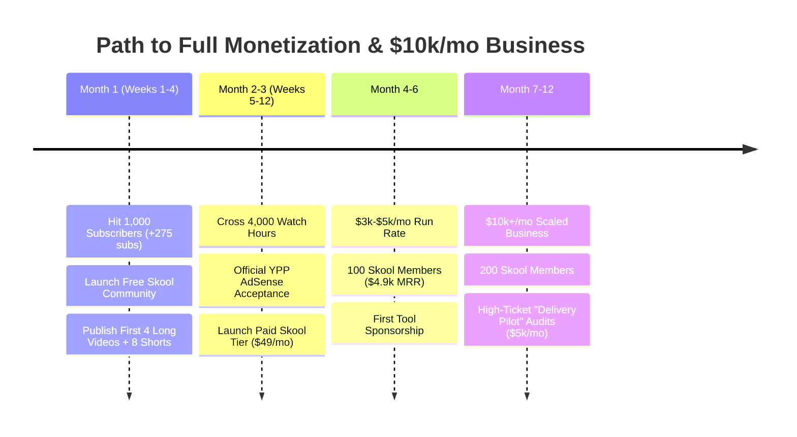
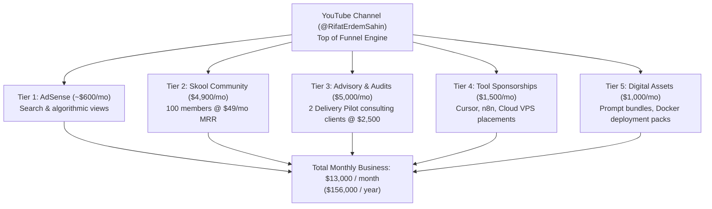

# YouTube Monetization Timeline & Content Business Blueprint

Channel: **[@RifatErdemSahin](https://www.youtube.com/@RifatErdemSahin)**  
Live Baseline (November 2026): **725 Subscribers** | **40 Videos Published**  
Distance to YouTube Partner Program (YPP): **Only 275 Subscribers to 1,000**

---

## 1. Executive Summary & Timeline Estimates



| Phase | Milestone | Estimated Timeline | Probability | Primary Revenue Stream |
| :--- | :--- | :---: | :---: | :--- |
| **Phase 1: Partner Program (YPP)** | 1,000 Subs + 4,000 Watch Hours | **60 – 90 Days** *(Jan - Feb 2027)* | **92%** | YouTube AdSense ($300 - $600/mo) |
| **Phase 2: Community Monetization** | 100 Paid Skool Members ($49/mo) | **90 – 150 Days** *(Mar - Apr 2027)* | **85%** | Skool MRR ($4,900/mo) |
| **Phase 3: High-Ticket & Sponsorships** | Corporate Advisory & Brand Deals | **180 – 270 Days** *(Jun - Sep 2027)* | **78%** | Advisory ($5k/mo) + Sponsors ($2k/mo) |
| **Full Business Scale** | **Sustainable $10,000+/month** | **6 – 9 Months** | **80%** | Diversified Multi-Tier Portfolio |

---

## 2. YouTube Partner Program (YPP) Math & Gap Analysis

### Official YouTube Partner Requirements
1. **Subscribers:** 1,000 required.
   - Current: **725**.
   - Deficit: **275 subscribers**.
   - With 1 Long Video + 3 Shorts per week generating an average of +35 to +50 subs/week, **1,000 subscribers will be reached in 6 to 8 weeks**.
2. **Watch Hours:** 4,000 valid public watch hours within 365 days *(or 10M Shorts views in 90 days)*.
   - *Strategic Rule:* For technical AI/DevOps creators, **4,000 watch hours on long tutorials is 100x easier and more valuable** than 10M Shorts views.

### Watch Hours Velocity Calculation

$$\text{Total Watch Hours} = \frac{\text{Total Views} \times \text{Average View Duration (mins)}}{60}$$

| Content Type | Avg Video Length | Avg Retention (APV) | Watch Time per View | Views Needed for 1,000 Hours | Views Needed for 4,000 Hours |
| :--- | :---: | :---: | :---: | :---: | :---: |
| **Short-Form (Shorts)** | 45 secs | 80% (36 secs) | 0.010 hrs | 100,000 views | 400,000 views *(doesn't count toward 4k YPP)* |
| **Standard Tutorial** | 18 mins | 42% (7.5 mins) | 0.125 hrs | 8,000 views | 32,000 views |
| **Cornerstone Masterclass** | 50 mins | 35% (17.5 mins) | 0.291 hrs | 3,436 views | 13,745 views |

> [!IMPORTANT]
> **The Secret Weapon for Watch Time:** 
> Publishing just **two 50-minute Masterclasses** (e.g., "The Complete Delivery Pilot Masterclass" and "Agentic RAG from Zero to Production") that average 2,500 views each produces **~1,455 watch hours** alone—over 36% of the entire 4,000-hour requirement!

---

## 3. The 3 Timeline Scenarios to Full YPP Monetization

```
Baseline: 725 subs | Need: +275 subs & 4,000 watch hours
```

### Scenario A: Aggressive Sprint (45 – 60 Days)
* **Cadence:** 2 Long Tutorials/week + 4 Shorts/week + 1 Masterclass/month.
* **Velocity:** ~65 subs/week, 700 watch hours/week.
* **YPP Monetization Date:** **Mid-January 2027**.
* **Driver:** One technical tutorial on n8n or Claude Code hits YouTube search/suggested algorithm and gets 15k+ views.

### Scenario B: Recommended Steady Pace (75 – 90 Days) — *Target Plan*
* **Cadence:** 1 Long Tutorial/week (Wed) + 3 Shorts/week (Mon/Thu/Fri) + 1 Bi-weekly Masterclass (Sat).
* **Velocity:** ~35–45 subs/week, 350–450 watch hours/week.
* **YPP Monetization Date:** **Mid-February 2027**.
* **Driver:** Consistent weekly releases compounding with back-catalog search traffic.

### Scenario C: Conservative Buffer (120 – 150 Days)
* **Cadence:** 1 Long Tutorial every 10 days + 2 Shorts/week.
* **Velocity:** ~20 subs/week, 200 watch hours/week.
* **YPP Monetization Date:** **April 2027**.

---

## 4. The 5-Tier Content Business Model (Beyond AdSense)

AdSense in the AI & Tech niche pays high RPMs ($15 – $30 per 1,000 views), but AdSense alone will only yield $400–$900/month at 30k monthly views. The true business engine is built on **high-margin back-end offerings**.



### Revenue Tier Breakdown

| Tier | Monetization Mechanism | Price Point | Volume / Month | Monthly Revenue | Annual Run Rate |
| :--- | :--- | :---: | :---: | :---: | :---: |
| **Tier 1: YouTube AdSense** | Tech niche CPM ($20 RPM avg) | ~$20 / 1k views | 30,000 views | **$600** | $7,200 |
| **Tier 2: Skool Community MRR** | Weekly clinics, workflow JSONs, networking | $49 / month | 100 members | **$4,900** | $58,800 |
| **Tier 3: Advisory / Delivery Pilot Audits** | 1-on-1 team AI architecture audit & setup | $2,500 one-off | 2 clients | **$5,000** | $60,000 |
| **Tier 4: Software Sponsorships** | Dedicated video sponsor / newsletter ad | $750 / video | 2 sponsors | **$1,500** | $18,000 |
| **Tier 5: Digital Asset Bundles** | Production n8n templates & Docker packs | $49 one-off | 20 purchases | **$980** | $11,760 |
| **TOTALS** | **Full Ecosystem Potential** | — | — | **$12,980 / mo** | **$155,760 / yr** |

---

## 5. Strategic 4-Phase Roadmap to a $10k/Month Business

### Phase 1: The YPP & Community Seeding Sprint (Days 1 – 60)
* **Main Goal:** Cross 1,000 YouTube subscribers and onboard first 200 free members into Skool.
* **Key Actions:**
  * Execute Week 1–4 Content Calendar (n8n workflows, Delivery Pilot shift).
  * Place free workflow JSON lead magnets in every video description and pinned comment.
  * Host free weekly live debugging sessions inside Skool to establish deep community trust.
* **Monthly Revenue:** $0 – $500 (advisory inquiries).

### Phase 2: AdSense Activation & Paid Tier Launch (Days 61 – 120)
* **Main Goal:** Turn on YouTube AdSense monetization and introduce paid Skool tier ($49/month or $490/year).
* **Key Actions:**
  * Apply for YouTube Partner Program upon hitting 4,000 watch hours.
  * Introduce "Delivery Pilot Pro" cohort inside Skool (advanced agent architectures, private office hours, code repository).
  * Convert 30–50 members into founding paid members (generating $1,500 – $2,500/mo MRR).
* **Monthly Revenue:** $2,500 – $4,000/mo.

### Phase 3: Sponsorships & High-Ticket Advisory (Days 121 – 200)
* **Main Goal:** Reach 100 paid Skool members ($4.9k MRR) and secure initial AI dev tool sponsors.
* **Key Actions:**
  * Package a media kit for AI dev tools (IDE extensions, vector databases, VPS hosts).
  * Offer high-ticket "Delivery Pilot Architecture Audits" ($2,500) for software agencies wanting to transition developers to AI pilots.
* **Monthly Revenue:** $6,000 – $8,500/mo.

### Phase 4: Mature Autonomous Flywheel (Days 201 – 360)
* **Main Goal:** Stable $10,000 – $15,000/month diversified recurring business.
* **Key Actions:**
  * 200+ Skool members ($9,800 MRR).
  * Recurring quarterly enterprise training workshops.
  * Established back-catalog of 75+ YouTube videos generating passive search views, watch hours, and community leads 24/7.
* **Monthly Revenue:** $12,000 – $16,000/mo.

---

## 6. Critical Success Factors & Avoidable Pitfalls

1. **Do NOT Rely on AdSense Alone:** Many creators stop at AdSense and earn $300/mo for full-time work. Your Skool community is your financial engine.
2. **Optimize for Search First, Virality Second:** In AI engineering, evergreen tutorials (e.g. *"How to connect n8n to local Ollama with Docker"*) generate steady watch hours and high-intent Skool leads for 2+ years.
3. **Use Course Masterclasses to Accelerate Watch Time:** A single 50-minute video can generate 1,000+ watch hours in 3 weeks if structured with actionable chapters and homework.
4. **Consistency Over Perfection:** Publishing 1 Long tutorial + 3 Shorts every single week for 12 weeks guarantees algorithmic compounding.
