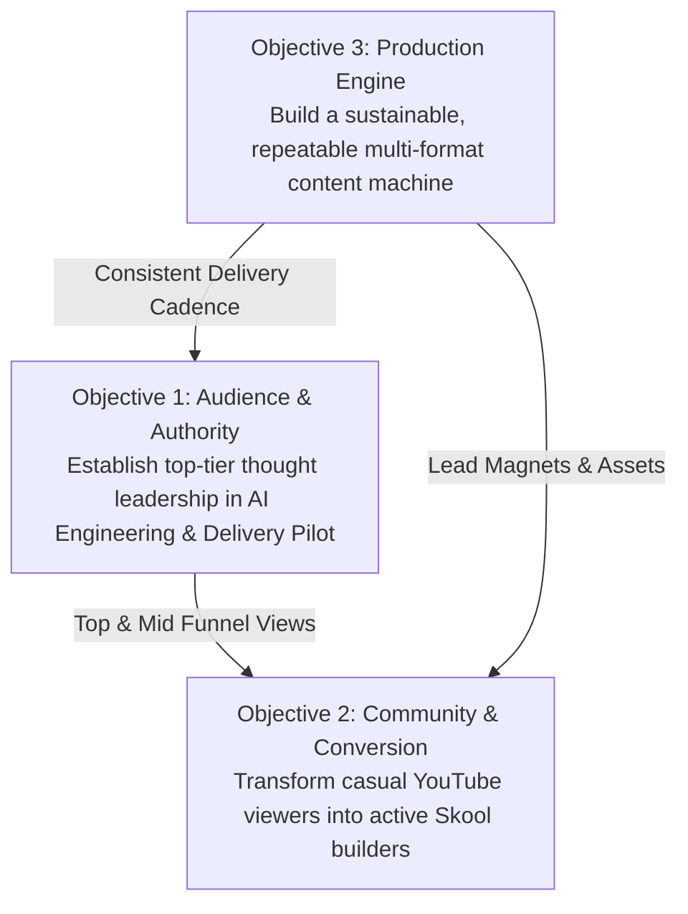

# Objectives & Key Results (OKRs): YouTube (@RifatErdemSahin) & Skool Community

**Cadence:** 90-Day Strategic Cycle (Quarterly)  
**Review Frequency:** Weekly Scorecard Review & Monthly Retrospective  
**Scoring Model:** Google OKR standard (0.0 to 1.0; 0.7 = target hit; 1.0 = exceptional stretch)

---

## Strategic Summary



---

## 🎯 Objective 1: Establish Dominant Authority in AI Engineering & the "Delivery Pilot" Movement

> **Focus:** Expand top-of-funnel reach, establish authoritative positioning around AI transformation, n8n automation, and multi-agent systems.

| Key Result (KR) | Baseline | Target (0.7) | Stretch (1.0) | Current Actual | Score |
| :--- | :---: | :---: | :---: | :---: | :---: |
| **KR 1.1: Subscriber Growth**<br>Grow YouTube channel subscribers | Baseline | +3,500 | +5,000 | Pending | 0.0 |
| **KR 1.2: Total Video Impressions & Views**<br>Total quarterly views across formats (Long + Shorts) | Baseline | 120,000 views | 200,000 views | Pending | 0.0 |
| **KR 1.3: Audience Retention & Engagement**<br>Maintain >42% Average Percentage Viewed (APV) on long-form and >75% Viewed vs Swiped Away on Shorts | — | 40% APV<br>72% Shorts | 45% APV<br>78% Shorts | Pending | 0.0 |
| **KR 1.4: Publishing Discipline**<br>Publish all scheduled calendar items (12 Long-form tutorials, 24 Shorts, 4 Course Masterclasses) | 0 | 90% (36/40) | 100% (40/40) | Pending | 0.0 |

---

## 🎯 Objective 2: Build a Vibrant, High-Value Skool Community of AI Practitioners

> **Focus:** Convert passive viewers into engaged community members who build, share projects, and attend live sessions.

| Key Result (KR) | Baseline | Target (0.7) | Stretch (1.0) | Current Actual | Score |
| :--- | :---: | :---: | :---: | :---: | :---: |
| **KR 2.1: New Member Onboarding**<br>Acquire new verified members into the Skool community from YouTube referral links | Baseline | +350 members | +500 members | Pending | 0.0 |
| **KR 2.2: Lead Magnet Conversion**<br>Achieve a >8% click-to-join conversion rate on description/pinned comment links for workflow JSONs & blueprints | — | 7.0% | 10.0% | Pending | 0.0 |
| **KR 2.3: Community Activation (Building vs Lurking)**<br>Generate >120 member capstone/workflow share posts in the community showcase | 0 | 90 posts | 150 posts | Pending | 0.0 |
| **KR 2.4: Live Office Hours Engagement**<br>Host 8 live workflow clinics / Q&A office hours with >30 average live participants | 0 | 6 sessions<br>25 attendees | 8 sessions<br>40 attendees | Pending | 0.0 |
| **KR 2.5: 30-Day Member Retention**<br>Maintain a 30-day active retention rate (DAU/MAU) > 35% | — | 30% | 40% | Pending | 0.0 |

---

## 🎯 Objective 3: Build a Streamlined, Sustainable Production & Repurposing Engine

> **Focus:** Eliminate production bottlenecks through standard templates, automated checklists, and repurposing pipelines.

| Key Result (KR) | Baseline | Target (0.7) | Stretch (1.0) | Current Actual | Score |
| :--- | :---: | :---: | :---: | :---: | :---: |
| **KR 3.1: Lead Time to Publish**<br>Reduce total turnaround time per long-form video (outline to scheduled) to < 6 hours | 10+ hrs | 6.5 hrs | 5.0 hrs | Pending | 0.0 |
| **KR 3.2: 100% Asset Coupling**<br>Ensure 100% of long-form and course videos launch with a downloadable Skool resource (JSON, repo, prompt pack) | — | 95% | 100% | Pending | 0.0 |
| **KR 3.3: 48-Hour Repurposing Turnaround**<br>Extract and schedule at least 2 Shorts from every long-form video within 48 hours of primary recording | — | 85% | 100% | Pending | 0.0 |
| **KR 3.4: Content Buffer (Lead Time)**<br>Maintain a minimum 10-day buffer of scheduled videos to avoid burnout and last-minute rushes | 0 days | 7 days | 14 days | Pending | 0.0 |

---

## 📊 Weekly OKR Tracking Scorecard Template

Track progress at the end of every Sunday review:

```markdown
### Week [X] Review (Date: __________)

| Metric | Target (Cumulative) | Actual (Cumulative) | Delta | Notes / Blockers |
| :--- | :---: | :---: | :---: | :--- |
| YouTube Subscribers | | | | |
| Total YouTube Views | | | | |
| Shorts Published (WTD) | 2 | | | |
| Long-Form Published (WTD) | 1 | | | |
| Course Modules (Monthly) | | | | |
| New Skool Members (WTD) | | | | |
| Skool Lead Magnet Clicks | | | | |
| Community Posts / Shares | | | | |

**Key Learnings from this week:**
- What worked well:
- What lagged or missed:
- Adjustment for next week:
```
