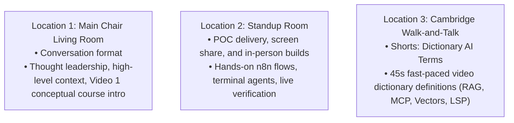

# Top-Performing Video Benchmarks & Production Shoot Logistics

Channel: **@RifatErdemSahin**  
Ecosystem: **YouTube & Skool Community**

---

## 1. Top-Performing Video Archetypes & Channel Benchmarks

Based on channel performance themes on [@RifatErdemSahin](https://www.youtube.com/@RifatErdemSahin), videos achieve peak retention and subscriber conversion when they blend **provocative mindset shifts** with **tangible technical demonstrations**.

```
┌────────────────────────────────────────────────────────────────────────┐
│  Archetype A: The "Delivery Pilot" Shift (Philosophy + Career)          │
│  "Riders vs Drivers vs Pilots: The Truth About AI Devs"                │
├────────────────────────────────────────────────────────────────────────┤
│  Archetype B: Practical AI Workflows (Hands-on Automation)             │
│  "AI Job Hunter / CV Automation with Agents & n8n"                     │
├────────────────────────────────────────────────────────────────────────┤
│  Archetype C: Developer Environment & Tool Hacks (Efficiency)          │
│  "Optimizing AI IDEs, Token Usage, and Terminal Agents"                │
├────────────────────────────────────────────────────────────────────────┤
│  Archetype D: Enterprise RAG & Knowledge Systems (Deep Dive)           │
│  "Agentic RAG with Hybrid Search: Stop Using Naive Vectors"            │
└────────────────────────────────────────────────────────────────────────┘
```

---

## 2. Detailed Breakdown of Top Sample Videos

### Sample Video 1: "The Delivery Pilot: From AI Driver to Fleet Orchestrator"
* **Format:** Long-Form (15–20 mins) + 2 Repurposed Shorts
* **Channel Theme:** Career transition, AI transformation, engineering mindset.
* **Core Concept:** Explaining the 3 tiers of AI users in tech:
  1. *The Rider:* Passive user prompting ChatGPT for basic chat answers.
  2. *The Driver:* Developer using Copilot for inline auto-completion.
  3. *The Pilot:* Systems engineer directing autonomous agent swarms, managing quality, testing, and delivery.
* **Why it Performs:** High emotional resonance with developers anxious about AI, high shareability on LinkedIn/Twitter.

---

### Sample Video 2: "Building an Autonomous AI Job Hunter / Application Agent"
* **Format:** Long-Form Tutorial (18–25 mins) + 3 Shorts
* **Channel Theme:** Real-world utility, automation with n8n and LLM scrapers.
* **Core Concept:** A fully automated pipeline that monitors job boards, parses descriptions, matches against a personal knowledge base, tailors a CV, and alerts via Zulip/Telegram.
* **Why it Performs:** Clear immediate ROI for the viewer; demonstrates n8n + API integration visually.
* **Skool Lead Magnet:** Ready-to-import n8n workflow `.json` + prompt template inside the Skool Classroom.

---

### Sample Video 3: "My Minimalist AI Terminal & IDE Setup (Claude, Cursor, CLI)"
* **Format:** Mid-Length Video (12–15 mins) + 2 Shorts
* **Channel Theme:** Developer experience, token optimization, speed.
* **Core Concept:** Live walk-through of Rifat's terminal setup: dotfiles, hotkeys, token monitoring, and multi-window agent orchestration.
* **Why it Performs:** Developers obsess over other developers' setups; highly actionable within 10 minutes of watching.
* **Skool Lead Magnet:** GitHub repo with config dotfiles and CLI cheat sheet.

---

### Sample Video 4: "Agentic RAG Masterclass: Building Private Knowledge Engines"
* **Format:** Coursera-Style Modular Course (3 x 5-minute videos = 15 min module) for Skool Classroom
* **Channel Theme:** Deep technical authority, architecture, enterprise systems.
* **Core Concept:** Moving past naive vector embeddings into hybrid search, semantic chunking, and self-correcting query decomposition.
  * *Video 1 (5m):* The Mental Model (Main Chair Living Room Conversation)
  * *Video 2 (5m):* POC Delivery & Live Code Screen Share (Standup Room)
  * *Video 3 (5m):* Hardening, Error Handling & Capstone Challenge (Standup Room)
* **Why it Performs:** Evergreen search volume; bite-sized 5-minute videos achieve >85% completion rates inside Skool.
* **Skool Lead Magnet:** Complete source code repo, sample dataset, and homework challenge in the Skool Classroom.

---

## 3. Production Time Estimates (Per Format)

Standardized time budgets prevent burnout and ensure consistent weekly publishing.

| Stage | Shorts (35–55s) | Long Tutorial (15–20m) | Course Masterclass (45–75m) |
| :--- | :---: | :---: | :---: |
| **1. Pre-Production**<br>• Research, outline, code prep, testing scripts | 30 mins | 1.5 hrs | 3.0 hrs |
| **2. Production / Shooting**<br>• Talking head (A-roll), screen capture, B-roll | 30 mins | 1.5 hrs | 2.5 hrs |
| **3. Post-Production**<br>• Editing, jump-cuts, zoom punch-ins, audio mastering | 45 mins | 2.5 hrs | 4.5 hrs |
| **4. Packaging & Publishing**<br>• Thumbnail design, title A/B testing, description | 15 mins | 45 mins | 1.0 hr |
| **5. Skool Companion Asset**<br>• JSON export, code cleanup, community prompt post | 10 mins (link only) | 45 mins | 1.5 hrs |
| **TOTAL TIME PER ASSET** | **~2 hrs 10m**<br>*(or 45m if cut from Long)* | **~7 hrs** | **~12.5 hrs** |

> [!TIP]
> **Batching Efficiency:** If you extract **2 Shorts** directly from the Long Video during the editing phase, the incremental time per Short drops from **130 minutes down to 25 minutes**.

---

## 4. Studio & Setups: Shooting Locations & Logistics

To produce high-retention content without complex studio overhead, categorize filming into **3 distinct physical setups**:



### Location 1: Main Chair Living Room (Conversation Format)
* **Format & Style:** Relaxed, conversational, sitting in an armchair or couch. Direct-to-camera or interview/fireside dialogue.
* **What to shoot here:**
  * Mindset shifts, Delivery Pilot philosophy, career advice, and industry trends.
  * **Video 1 of each Coursera-style Skool Module (5 mins):** The conceptual framework and why it matters before touching any code.
* **Requirements & Setup:**
  * **Visual:** Warm living room ambient lighting, shallow depth-of-field (bokeh), clean aesthetic.
  * **Camera:** 4K mirrorless / iPhone on eye-level tripod with 35mm-equivalent portrait lens.
  * **Audio:** Wireless lapel / lavalier microphone (DJI Mic / Rode Wireless GO) or directional shotgun mic just out of frame.
* **Why it Works:** Strips away cold tech sterility and builds human connection, trust, and relatable mentorship.

---

### Location 2: Standup Room (POC Delivery Screen Share & In-Person)
* **Format & Style:** Dynamic, standing presentation combined with high-resolution screen sharing and in-person demonstration.
* **What to shoot here:**
  * Live Proof-of-Concept (POC) delivery, architecture diagrams, and software delivery pipelines.
  * **Video 2 & Video 3 of each Coursera-style Skool Module (5 mins each):** Hands-on POC build + production hardening & homework assignment.
* **Requirements & Setup:**
  * Standup desk or presentation podium with secondary display / screen capture mirror.
  * Lapel / Wireless Lav microphone for unrestricted energetic movement.
  * Screen capture software (OBS Studio / ScreenFlow / Loom) recording 4K/60fps crisp code and terminal text.
* **Why it Works:** Standing up injects physical energy and urgency into technical screen-shares, keeping viewers awake through code walk-throughs.

---

### Location 3: Cambridge Walk-and-Talk (Shorts: Dictionary AI Terms)
* **Format & Style:** Mobile, energetic outdoor walk through Cambridge streets and parks.
* **What to shoot here:**
  * **YouTube Shorts "AI Dictionary" Series:** Bite-sized 45-second explanations of 1 specific AI term per short:
    * *What is a Vector Embedding?* (e.g. "Horse + Wings = Pegasus")
    * *What is LSP (Language Server Protocol)?*
    * *What is RAG (Retrieval-Augmented Generation)?*
    * *What is MCP (Model Context Protocol)?*
    * *What is Quantization?*
    * *What is an Agentic Loop?*
* **Requirements & Setup:**
  * Smartphone with wide-angle lens held at arm's length or on a small handheld gimbal.
  * Wireless clip-on microphone with wind muff (**deadcat**) essential for crisp audio while moving.
  * Natural daylight (overcast or late afternoon golden hour).
* **Shooting Time Efficiency:** Batch-record 5–8 "Dictionary AI Terms" Shorts in a single 45-minute walk around Cambridge.

---

## 5. Weekly Batch Production Schedule (The 1-Day Production Block)

Rather than filming every day, follow this high-output weekly workflow:

| Day | Time Block | Action | Output Generated |
| :--- | :--- | :--- | :--- |
| **Monday AM** | 09:00 - 11:30 | **Pre-Production:** Outline Wednesday's long video & prep code/workflow | 1 Solid Brief + Tested Demo |
| **Monday PM** | 13:00 - 15:30 | **Shooting Block (Desk):** Record Long-Form A-roll + Screen capture | 1 Master Raw Long Video |
| **Tuesday AM** | 09:00 - 12:00 | **Post-Production:** Edit long video, create thumbnail, export JSON | 1 Ready Long Video + Skool Asset |
| **Tuesday PM** | 13:00 - 14:30 | **Repurposing Block:** Cut 2 Shorts from the master edit + add captions | 2 Finished Shorts |
| **Thursday PM** | 16:00 - 17:00 | **Outdoor Walk (Cambridge):** Film 3 quick mindset Short hooks | 3 Finished B-roll / Hook Shorts |

**Total Production Commitment:** ~10.5 hours per week to generate **1 Long Video, 3-5 Shorts, and 1 Skool asset**.
